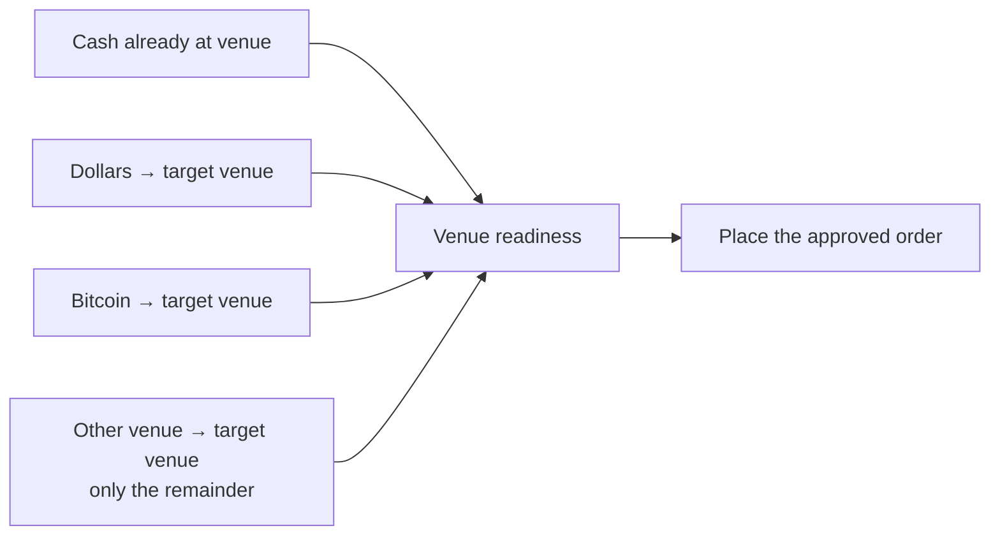

# How Kute moves money

For an order in a venue, fund that venue directly whenever a supported,
approved route exists. Dollars is a source, not a compulsory intermediate stop.

This is a readable contract for the routing code and future regression tests.
The source files linked below execute the policy. This document does not change
routes, provider availability, fees, or approvals. It describes the 2.1.2
routing contract. Candidate validation and device acceptance belong in the
release record.

## The balances mean different things

| Name in this document | What actually holds the money |
| --- | --- |
| Bitcoin | Spending wallet's Spark BTC. Savings/on-chain and Ledger paths have separate signing rules. |
| Dollars | USDB token on Spark, `spark:USDB`. This is one component of the combined Investments balance. |
| Predictions | Polymarket cash. Incoming `polygon:USDC.e` must become spendable pUSD before a bet. |
| Investing | Hyperliquid USDC on HyperCore. A HIP-3 market such as `xyz:TSLA` has a separate DEX clearinghouse. |

An Investments total is a presentation of several balances. It does not mean
the money is already in the account that can place a particular order.

## What happens when someone confirms a bet or order

Use sources in this order: cash already in that venue, then Dollars, then
Bitcoin, then the other venue only for the remaining shortfall. The last source
is deliberately last because pulling money between venues adds settlement work.
A remainder below a route minimum can fold into the Bitcoin leg within its
approved cap. “Available” still shows the total.

Source selection is implemented by `planOrderSources` and `decideOrderSources`
in [bitcoin_funded_order.dart](../lib/services/one_balance/bitcoin_funded_order.dart).
When existing funds cover a plan, the order slip and bet slip fund it in place.
If every spendable source is known to be zero, the slip instead opens its
contextual deposit entry so the person can add funds. Unknown or loading
balances do not qualify as zero. A short wallet can still open Receive to
obtain money. The known-zero exception is separate from sending existing funds
through an unnecessary deposit detour.
The deposit leaves the slip open and refreshes it on completion; placing the
order still needs an explicit approval. It does not queue an order or preserve
an old approval. Add margin keeps its existing behavior. See
[empty_slip_sources.dart](../lib/services/one_balance/empty_slip_sources.dart)
and [slip_shortfall.dart](../lib/screens/shared/slip_shortfall.dart).

Selected external source legs start together after approval. Readiness can
start on the first arrival and the order waits until the target venue can
actually cover it. “Priority” chooses how much each source contributes; it
does not require finishing the Dollars leg before starting the Bitcoin leg.
See [money_steps.dart](../lib/services/one_balance/money_steps.dart),
[bitcoin_funded_order.dart](../lib/services/one_balance/bitcoin_funded_order.dart),
and [venue_cash_funded_order.dart](../lib/services/one_balance/venue_cash_funded_order.dart).

### Bitcoin five-minute Up/Down: transfer, then place

The spending wallet's canonical Bitcoin five-minute Up/Down buy slip has a
separate funding action. In the same modal, “Transfer to Polymarket” moves the
selected sources and readies the cash; it never queues a bet or authorizes
autofire. Once spendable pUSD covers the fee-inclusive requirement and the
venue's balance/readiness checks, the action becomes “Place bet”. A fresh tap
reviews the current order and asks its order approval. Funds already ready at
Polymarket can go straight to this explicit order step. The actual buy and Max
sizing also use fresh spendable pUSD/CLOB readings, so a stale combined display
does not reject cash already ready to spend. Native checks before signing still
apply. Ledger, sells and other market flows keep their existing behavior.

The transfer uses the same source priority and direct routes described above,
with one scoped transfer approval and per-source/aggregate caps. That approval
cannot authorize a bet. Conversion and allowance work can ready existing venue
cash without moving another source. Unknown balances never count as zero; a
proven empty wallet uses the contextual deposit entry. Closing or expiring the
round cannot cause a late automatic bet: transferred cash remains venue cash
for a later explicit order. An uncertain transfer result is checked by reading
the balance rather than automatically sending it again.

Series detection uses canonical metadata, not title matching. See
[crypto_round.dart](../lib/services/polymarket/crypto_round.dart),
[bet_slip_sheet.dart](../lib/screens/polymarket/components/bet_slip_sheet.dart),
[predictions_prefund_transfer.dart](../lib/services/one_balance/predictions_prefund_transfer.dart)
and [venue_intents.dart](../lib/helpers/venue_intents.dart).

## What makes a funded order ready

Every new approved attempt starts its own receipt and step graph. A completed
Bitcoin or venue leg from an older stopped attempt is not copied into the new
receipt. The old record remains in history. The queued intent is bound to the
current funded run before money or its record can change; delayed callbacks
must not update a replacement attempt. See
[funded_orders.dart](../lib/services/one_balance/funded_orders.dart) and
[pending_polymarket_bet_provider.dart](../lib/providers/pending_polymarket_bet_provider.dart).

A generic deposit notification is a wake-up signal, not proof that every source
leg arrived. Aggregate delivery means the current attempt's own source legs
have completed. Readiness may begin on the first arrival, but a partial arrival
cannot make the whole order ready. See
[pending_bet_autofire.dart](../lib/providers/pending_bet_autofire.dart) and
[predictions_venue_cash_order.dart](../lib/services/one_balance/predictions_venue_cash_order.dart).

For a Predictions buy, the required amount is the executable quote's full
`allInMax`, including the live best-ask fee calculation and rounding headroom.
Fresh on-chain pUSD and the venue's balance/allowance readiness must cover that
whole amount before ready or post. Cached pUSD plus unconverted USDC.e is not
usable collateral. Conversion, allowance updates and venue recounts happen
before signing; an unknown or still-short answer keeps the approved order
waiting within its bounds, never authorizes a post or another funding send.
Staggered arrivals join one conversion/recheck rather than start overlapping
ones. See [venue_collateral.dart](../lib/services/polymarket/venue_collateral.dart).

Only after this attempt's own complete delivery is proved can a funded market
bet resize to a genuinely short arrival. It sizes from confirmed pUSD and a
fresh book within the existing approval cap. A partial or unrelated deposit
cannot authorize that resize. If final collateral confirmation exhausts its
bounded wait, the stop reason is `balance_confirmation_timeout`, reported as
funding stage `credit` / error category `timeout`; no order was signed or sent.
The funding journey reaches credited only at the final usable-collateral proof,
so funding waits are not counted as order-placement or policy work.

## Available money while a move is in progress

A successful fresh Bitcoin read replaces the cached source amount even when
the new reading is lower or zero. A failed read can retain the last known
figure, but the verified send still checks actual funds; an unavailable read
is not proof of zero. See
[bitcoin_funded_order.dart](../lib/services/one_balance/bitcoin_funded_order.dart).

An accepted venue-cash send debits the matching wallet's cached source once per
operation. Use the lower raw/published pre-send balance so an already-updated
source is not debited twice. Pending-operation ceilings keep a late source read
from restoring moved cash beside the destination arrival. Two transfers from
the same venue remain independent; only each operation's own delivered/refunded
proof plus a newly requested source snapshot reconciles it. Generic failure or
unknown status does not prove a refund. Wallet generations reject late reads
across a switch away and back. A newly requested provider snapshot is still
unversioned, which remains a freshness limitation. See
[investments_spendable.dart](../lib/services/one_balance/investments_spendable.dart)
and [venue_cash_source.dart](../lib/services/one_balance/venue_cash_source.dart).

For a Bitcoin purchase, an unsent Dollars remainder below the $1 floor or the
directed USDB → BTC route minimum stays in Dollars. Its purchase step is skipped,
with no approval, quote or native send for a known sub-floor amount and no
pending retry or “Needs attention” item for that remainder. Valid venue → Bitcoin
legs continue independently; the receipt stays pending until their actual rows
settle and Bitcoin credit is counted. Sent totals include only the source legs
that actually went, including their source fees, and never claim that retained
Dollars became Bitcoin. A pre-funding `amount_too_small` quote refusal is also
safe to skip; a failure after funding begins keeps its real settlement outcome.
Unknown route limits do not prove a below-minimum amount. The shared directed
minimum read is single-flight, bounded to 3 s and cached using the existing
10-minute success / 1-minute unknown retry policy. See
[dollars_to_bitcoin_minimum.dart](../lib/services/one_balance/dollars_to_bitcoin_minimum.dart),
[dollars_to_bitcoin_purchase.dart](../lib/services/one_balance/dollars_to_bitcoin_purchase.dart),
[pending_bitcoin_purchase.dart](../lib/services/one_balance/pending_bitcoin_purchase.dart)
and [buy_bitcoin_steps.dart](../lib/services/one_balance/buy_bitcoin_steps.dart).

## Live Bitcoin, Dollars and Activity refresh

Balances and Activity are separate cached SDK snapshots. On a `Synced` burst,
the wrapper reads and publishes both immediately, then again after the existing
300 ms settling interval. A payment-metadata event refreshes payment rows
without inventing another payment outcome. Balance and payment-list reads run
independently in both the wrapper and pipeline attachment: a failed or stalled
read must not suppress publication from the other. Retired wallet sessions and
older overlapping reads cannot publish into a replacement session.

Pull-to-refresh publishes the cached snapshots immediately, joins the shared
native sync, then reads both again when that sync finishes, including after an
error. The 20 s foreground wait is a UI ceiling, not native cancellation: a late
completion still triggers its final readback. These reads explicitly use
`getInfo(ensureSynced: false)`; they read stored state rather than waiting again
for initial synchronization. A successful native sync return alone does not
prove that every native sub-step refreshed its data. See
[sdk_instance.dart](../lib/models/breez/sdk_instance.dart) and
[push_pipeline.dart](../lib/services/sync/push_pipeline.dart).
The official Breez guidance for [balance reads](https://sdk-doc-spark.breez.technology/guide/get_info.html),
[events](https://sdk-doc-spark.breez.technology/guide/events.html) and
[payment history](https://sdk-doc-spark.breez.technology/guide/list_payments.html)
likewise calls for refreshing both snapshots after `Synced`.

This closes app-side publication gaps; it does not establish the cause of the
reported live-refresh stall or prove device recovery. Acceptance needs incoming
Bitcoin/Dollars and Activity updates, pull-to-refresh, and a longer open session
without restarting. Start this check with a full native app stop and relaunch:
Dart hot restart is insufficient evidence about native runtime or logger
lifetime. The [Flutter Rust Bridge handler guidance](https://cjycode.com/flutter_rust_bridge/guides/custom/rust/handlers)
describes isolate-port lifetime hazards across hot restart, without diagnosing
this incident.

Debug-only diagnostics use fixed event/read/sync labels and changed-state
booleans. They add no amounts, identifiers or raw
errors and do not enable PostHog in debug builds. See
[main.dart](../lib/main.dart) and the SDK/pipeline sources above.

## Deposit and movement directions

These are directed routes: support for A → B does not imply B → A. Every route
still requires the live catalog, runtime policy, minimum, verified quote and
the correct wallet ownership. “Direct” means no intermediate Dollars balance;
it can still involve a provider, source settlement and destination credit.

| From → to | Route and necessary follow-up | Code |
| --- | --- | --- |
| Bitcoin → Dollars | `spark:BTC → spark:USDB`, one Orchestra swap. | [Bitcoin leg](../lib/services/one_balance/bitcoin_to_dollars_leg.dart), [Move sheet](../lib/screens/home/components/deposit_sheet.dart) `_dispatchBtcToUsd` |
| Dollars → Bitcoin | `spark:USDB → spark:BTC`, one Orchestra swap. A Buy can pull an approved remainder from venue cash. | [Purchase](../lib/services/one_balance/dollars_to_bitcoin_purchase.dart), [purchase steps](../lib/services/one_balance/buy_bitcoin_steps.dart) |
| Bitcoin → Predictions | `spark:BTC → polygon:USDC.e` to the wallet's own Predictions deposit account, then convert to pUSD and confirm spendability. | [Direct Bitcoin leg](../lib/services/one_balance/bitcoin_to_venue_leg.dart) |
| Bitcoin → Investing | `spark:BTC → hypercore:USDC` to the own Investing account; HIP-3 then needs collateral at its DEX. | [Direct Bitcoin leg](../lib/services/one_balance/bitcoin_to_venue_leg.dart), [Spark/HyperCore service](../lib/services/funding/spark_hypercore_funding_service.dart) |
| Dollars → Predictions | `spark:USDB → polygon:USDC.e`, then pUSD readiness. | [Predictions funder](../lib/services/one_balance/predictions_venue_funder.dart) |
| Dollars → Investing | `spark:USDB → hypercore:USDC`; HIP-3 collateral readiness follows. | [Investing rail](../lib/services/one_balance/hyperliquid_move_rail.dart) |
| Predictions → Dollars | Convert pUSD to the withdrawable USDC.e when required, then `polygon:USDC.e → spark:USDB`. | [Predictions funder](../lib/services/one_balance/predictions_venue_funder.dart) `sweepToDollars` |
| Predictions → Bitcoin | `polygon:USDC.e → spark:BTC` after the necessary pUSD withdrawal conversion. | [Predictions funder](../lib/services/one_balance/predictions_venue_funder.dart) `sweepTo` |
| Predictions → Investing | `polygon:USDC.e → hypercore:USDC` directly to the same wallet's Investing account, after withdrawal conversion if needed. Ownership permits `pmHot → hlHot` in this direction. | [Predictions funder](../lib/services/one_balance/predictions_venue_funder.dart), [owned account guard](../lib/services/funding/owned_address_resolver.dart) |
| Investing → Dollars | Try native `hypercore:USDC → spark:USDB`. When refused before sending, the implemented alternative is HyperCore CCTP to the own Arbitrum standing instruction, then `arbitrum:USDC → spark:USDB`. | [Investing rail](../lib/services/one_balance/hyperliquid_move_rail.dart), [CCTP](../lib/services/hyperliquid/cctp_withdrawal.dart) |
| Investing → Bitcoin | Native `hypercore:USDC → spark:BTC` where supported; implemented CCTP alternative delivers to the own Bitcoin standing instruction. | [Move sheet](../lib/screens/home/components/deposit_sheet.dart) `_dispatchHyperliquidToBtc`, [CCTP](../lib/services/hyperliquid/cctp_withdrawal.dart) |
| Investing → Predictions | CCTP to the own Predictions standing instruction, then pUSD readiness. It avoids an intermediate Dollars balance. | [Cash sources](../lib/services/one_balance/venue_cash_source.dart), [CCTP](../lib/services/hyperliquid/cctp_withdrawal.dart) |

The HyperCore-source native routes were recorded as unavailable in this
candidate's implementation context, so their CCTP alternative matters. Catalog
and quote checks establish availability for the actual attempt; this document
is not a live provider status feed.

An explicitly chosen Bitcoin → Investments deposit can target the combined
balance's Dollars component. That is a different user action from confirming
a Hyperliquid order, whose Bitcoin leg targets HyperCore directly. The spending
wallet's normal Move sheet hides venue deposit/withdraw doors; Ledger keeps
separate device flows. See `spendingWalletLockedSide` and `ledgerMoveRoute` in
[deposit_sheet.dart](../lib/screens/home/components/deposit_sheet.dart).

## Money arriving from outside Kute

| Entry | How the destination is chosen |
| --- | --- |
| Spark BTC / Lightning / on-chain Bitcoin receive | Uses that wallet's native receive path; no cross-chain swap is necessary for a native Bitcoin receipt. |
| Other crypto → Bitcoin or Dollars | A supported directed Orchestra route converts the deposited asset to `spark:BTC` or `spark:USDB`. A reusable address additionally requires standing/accumulation-address support for that exact source and destination. |
| Cash App purchase | A Lightning-funded Orchestra order delivers to the selected supported destination. The external payment must actually arrive before conversion/delivery can complete. |
| Bank transfer | Coming-soon state in the Move sheet; it does not dispatch a payment. |

See [orchestra_routes.dart](../lib/services/orchestra_routes.dart),
[receive route availability](../lib/services/orchestra/receive_route_availability.dart),
[standing deposit store](../lib/services/orchestra/standing_deposit_store.dart),
and [Move sheet](../lib/screens/home/components/deposit_sheet.dart).
An advertised swap pair alone does not prove a reusable address can be minted.

## When a direct leg may use Dollars instead

The decision happens before that leg sends. A fallback is not permission to
retry a payment that might already have left.

| Fixed reason | Meaning |
| --- | --- |
| `no_own_deposit` | The wallet's own destination could not be established. |
| `refused_recently` | This direct route has a recent route-level refusal. |
| `estimate_unavailable` | Required pricing/readiness information did not arrive or was invalid. |
| `costlier` | The direct plan exceeds the compared via-Dollars cost. |
| `over_cap` | Required sats exceed the wallet or approved direct-leg limit. |
| `below_minimum` | The direct leg cannot meet the route minimum within the valid plan. |

The Bitcoin decision and `route_reason` values live in
[bitcoin_to_venue_leg.dart](../lib/services/one_balance/bitcoin_to_venue_leg.dart).
The direct Bitcoin → Hyperliquid plan must not wait on an irrelevant
Dollars-only route when it uses no Dollars. Its own route still needs a valid
estimate, minimum, destination, cost comparison and approval cap.

Venue cash has separate refusal codes. A temporary network/terms read can be
retried once while the same approval still covers it; a wallet ownership guard
refusal is not retried. A direct refusal before submission may replace the leg
with source → Dollars → destination steps. An ambiguous or already submitted
transfer is followed by status reconciliation instead. See
[venue_cash_source.dart](../lib/services/one_balance/venue_cash_source.dart) and
[settlement_http.dart](../lib/services/funding/settlement_http.dart).

Quotes pin the directed pair, amounts and own recipient. One user approval
limits each leg and the total. A changed or expired approval cannot silently
authorize more money. Automatic sweeping is disabled
(`kVenueAutoSweepEnabled = false` in
[venue_sweeper.dart](../lib/services/one_balance/venue_sweeper.dart)); money does
not move merely because the combined balance is displayed.

## Why a purchase can feel slow

An exchange order is the last stage, not the whole operation. The critical path
can be: fresh policy/location checks → estimates/quote → approval → source
send → provider registration → cross-chain delivery → venue credit/conversion
→ order submission → confirmed result. A via-Dollars route repeats the
quote/send/delivery sequence for its onward leg. A Predictions withdrawal can
also require a relayed pUSD conversion, and CCTP has its own transfer and
standing-order discovery stages. Independent source legs run in parallel;
dependent conversions and spends must wait for real funds.

There are two different delays: the funds arriving and the app noticing usable
funds. Orchestra delivery status, the SDK's token cache and the venue's
spendable-balance view are different signals. Updating a hero number does not
prove an order can spend it; a stale hero must not make an arrived deposit look
lost. The settlement graph distinguishes those steps.

### Current wait settings, not measured delivery times

| Wait | Code setting and meaning | Source |
| --- | --- | --- |
| Gated policy tap / manual connection check | 4 s / 5 s foreground bounds. They do not predict swap duration. | [Runtime capabilities](../lib/services/runtime_capabilities_service.dart), [region freshness](../lib/services/region_freshness.dart) |
| Direct Bitcoin route estimate / limits | Each has a 4 s request ceiling. Independent reads run together. | [Direct Bitcoin leg](../lib/services/one_balance/bitcoin_to_venue_leg.dart) |
| Direct funded leg delivery | Status every 1 s, slow indication after 2 min, foreground wait at most 12 min. | [Direct Bitcoin leg](../lib/services/one_balance/bitcoin_to_venue_leg.dart) `watchOrchestraLeg` |
| Bitcoin → Dollars arrival watcher | Cached check every 1 s; fresh reads every 300 ms for the first 60 s; slow after 2 min; at most 12 min. | [Bitcoin/Dollars leg](../lib/services/one_balance/bitcoin_to_dollars_leg.dart) |
| Venue-cash runner | Leg wait at most 12 min; after authoritative home-leg delivery, Dollars catch-up at most 30 s with 500 ms checks. | [Venue-cash runner](../lib/services/one_balance/venue_cash_funded_order.dart) |
| Hyperliquid account credit | Poll every 1 s for 30 s, then every 4 s; at most 12 min awaiting funds. | [Pending order](../lib/providers/pending_hyperliquid_order_provider.dart) |
| HIP-3 collateral transfer credit | Read every 300 ms, bounded at 8 s; retry reads without resending the transfer. | [DEX cash](../lib/services/hyperliquid/hypercore_dex_cash.dart) |
| Predictions collateral readiness | Venue recount reads every 1 s within a 10 s pass; account setup and conversion waits each have a 90 s ceiling. Funded confirmation remains bounded by the existing approval and funding wait. Unknown readiness never permits a post. | [Placement waits](../lib/services/polymarket/placement_waits.dart), [queued bet](../lib/providers/pending_bet_autofire.dart) |
| CCTP immediate watcher | Confirm every 1 s / watch every 4 s, for at most 20 min; persisted reconciliation continues separately. | [CCTP](../lib/services/hyperliquid/cctp_withdrawal.dart) |

These timers belong to different phases and are not a single end-to-end SLA.
A foreground timeout can leave money still settling. Persisted Activity and
reconciliation must continue to show where it is; timing out never means it is
safe to send the same funds again.

## Fees: direct routing is not a second fee promise

Read-only public backend policy checked on 16 October 2026 (revision 2).
These are the published purpose rates and conditional own-account rates before
any verified referral discount; a validated quote remains authoritative for a specific move.
Provider spread, network costs and exchange fees are separate.

| Direction / operation | Kute rate and qualification |
| --- | --- |
| Bitcoin → Dollars, Predictions or Investing | 0 bps (0%) |
| Dollars → own verified Investing or Predictions account | `investments_internal`: 0 bps unless published otherwise; ownership verification is required. |
| Dollars → Bitcoin, external destination or another chain | `usdb_swap_send`: 50 bps (0.50%) |
| Predictions → Dollars | `usdb_swap_deposit`: 0 bps |
| Predictions → own verified Investing | `investments_internal`: 0 bps unless published otherwise. |
| Investing → own verified Predictions | `investments_internal`: 0 bps unless published otherwise. |
| Predictions → Bitcoin | `predictions_send`: 50 bps (0.50%) |
| Investing → Bitcoin, generic withdrawal rule | `venue_withdrawal`: 50 bps (0.50%) |
| Other cross-chain crypto deposit / send | 50 bps (0.50%) |
| Standard fiat deposit | 100 bps (1%); the native Bitcoin fiat route has a specific waiver. |
| Hyperliquid builder fee on orders | Default/listed 10 tenths of a basis point = 1 bp = 0.01% of order notional; exchange fees are extra. |
| Polymarket builder fee on orders | Current CLOB builder rate: taker 20 bps (0.20%), maker 0; market/platform fees may also apply. |

The published purpose rates alone do not price every own-account transfer.
Dollars → own Investing/Predictions and supported own venue-to-venue moves can
qualify for the internal rate. Looking only at the ordinary Dollars-send rule
incorrectly labels every Dollars → own Investing move as a 0.50% send. A move
that does not qualify keeps the applicable ordinary rule. The app cannot choose
a fee by naming a rule; the verified quote and pinned terms decide the actual
charge. These mappings are not proof of the fee applied to an individual quote.

The published referral reduction is 20 basis points on a positive Kute
conversion fee: for an eligible verified referred session, 50 → 30 bps and
100 → 80 bps. It does not add a charge to a waived fee and does not establish a
discount on venue builder fees. A published `trading`
rule of `provider_default` with `bps: 0` does not mean venue trading is free.

The Hyperliquid rate is the configured production builder rate. Debug builds
can omit Kute's builder if its approval fails; release builds require the
configured approval and refuse that unapproved order. Do not infer production
builder revenue from the founder's debug trades. See `_builderFee` in
[hyperliquid_trading_provider.dart](../lib/providers/hyperliquid_trading_provider.dart).
Use the quote/provider's net amounts; do not subtract a fee a second time.

CCTP uses verified standing-instruction fee terms. A qualifying new own-Dollars
instruction can pin the internal rate at zero. A legacy `venue_withdrawal` label
or existing fee pin keeps its original terms; it is not repriced. Bitcoin
remains an exit. The public global policy does not establish a particular wallet's internal instruction,
so do not promise every Investing withdrawal is free.

The debug `[quote-guard] feeBps` is provider `feeBps` plus known `appFees`; absent
app-fee fields count as zero in that diagnostic. It omits other possible costs,
minimums, affiliate effects and rounding. It is not a charged receipt or proof
of which Kute fee rule applied.

App enforcement and quote amounts:
[standing_deposit_store.dart](../lib/services/orchestra/standing_deposit_store.dart),
[cctp_withdrawal.dart](../lib/services/hyperliquid/cctp_withdrawal.dart), and
[orchestra_fee_amount.dart](../lib/services/orchestra/orchestra_fee_amount.dart).
This snapshot does not modify backend policy or establish a particular
wallet's fee qualification.

## What improves speed

Implemented path improvements:

- Fresh policy and venue checks start after the tap on dedicated connections;
  manual/network changes recycle the shared connection pools. This avoids an
  old connection or request holding the old VPN result.
- Search and old saved HIP-3 descriptors retain the target DEX. The readiness
  line waits for that DEX's collateral credit; it never resends a transfer
  merely because indexing is slow. Bitcoin-only Investing plans skip irrelevant
  Dollars-only reads, and a short via-Dollars output stops explicitly.
- USDB catch-up keeps retrying a numeric reading that fails to reflect a new
  settled arrival, including an unchanged zero. After normal sync recovery, one
  guarded SDK reconnect can refresh its token store and re-subscribe existing
  listeners. It is excluded during native mutations, shared sync, pending
  outgoing payments and observed token optimization.
  The SDK source supports leaf-refresh failure and token Swap reservations as
  possible causes; the device's exact native cause remains unproven.
- The Investing and Predictions slips open the contextual deposit only after
  the sources are proven empty, including fresh synced SDK reads, known venue
  balances, no positive ledger conflict and no pending/waiting money. Loading
  or conflicting reads retain the ordinary flow.
- Predictions readiness uses the current attempt's aggregate delivery and
  full usable collateral. Source snapshots cannot count sent cash again beside
  its destination, and a new attempt never borrows old completed progress.

These describe implemented behavior, not measured end-to-end latency or device proof.
The following are proposed follow-ups, not additional changes in this hotfix:

| Improve actual completion | Improve the experience while it completes |
| --- | --- |
| Audit remaining unnecessary serial reads on each route, using the direct Bitcoin fix as the regression contract. | Check every entry path renders all source lines immediately and completes each independently, using the existing step widgets. |
| Measure repeated read/estimate calls before removing or caching any; reuse only policy allows explicitly permitted by execution gates. | Check “sent”, “delivered”, “crediting”, “converting” and “placing” stay accurate on slow and failed paths. |
| Extend authoritative delivery/credit notifications to paths still relying on their next polling tick, retaining polling for recovery. | Audit fallback copy and stopped runs so each names the remaining work and where funds are held. |
| Measure phase durations by route before tuning intervals or provider integrations; never infer settlement time from a timeout constant. | Verify no path claims success before venue confirmation or presents an unknown balance as $0.00. |

Existing graph and rendering: [money_steps.dart](../lib/services/one_balance/money_steps.dart),
[venue_readiness.dart](../lib/services/one_balance/venue_readiness.dart), and
[move_steps.dart](../lib/services/one_balance/move_steps.dart).
No new chrome is required. Measurements must use exact values and exclude keys,
addresses, payment/order identifiers and whole-wallet balances from analytics.

## What PostHog can prove

Documentation and event definitions describe instrumentation. They do not prove
that a particular build emitted it on a device. Debug builds remain muted by
default, as requested; user opt-out still applies. The latest production-shaped
receipt has to be checked after a permitted run with analytics enabled.

| Instrumentation | What it records |
| --- | --- |
| `order_funding_requested` | Hyperliquid's initial funding request before approval, distinct from the approved journey's single `order_funding_started`. |
| `order_funding_route_selected` | A route/reason change immediately, with exact `duration_ms`; identical route/reason selections are deduplicated. Optional `route_reason`, `funding_source`, `other_venue_used` and already-known `ms_leg_*` accompany the route. |
| Funding step, submitted and terminal events | Known `route`, `route_reason`, `other_venue_used` and per-source `ms_leg_bitcoin`, `ms_leg_dollars`, `ms_leg_predictions`, `ms_leg_investing`. Missing timings stay absent. The existing Hyperliquid emitter consumes its journey once, preventing duplicate outcomes and false later abandonment. |
| Bitcoin five-minute transfer-only funding | Existing funding events carry `funding_purpose=predictions_prefund`. A successful transfer ends with `order_funding_completed` / `outcome=funds_ready`, exact total/credit/available leg timings and no order-placement duration. Readying existing USDC.e uses the same started/completed funnel with `fund_usd=0` and the full readiness target as `amount_usd`; timeout is an existing credit-stage failure. This proves funds ready, not a bet placed. The quote uses the existing manual-move tag; analytics purpose is a separate field. |
| HIP-3 credit timing | `ms_dex_credit` spans the actual transfer start to target clearinghouse readiness; absent when there was no transfer. Failure can carry the elapsed wait. `ms_credit` ends and `ms_order` starts at actual collateral readiness. Pending credit is a fixed `dex_credit_pending` failure at the credit stage. |
| Predictions final collateral wait | Journey credited is reported only when full usable collateral is proved. An exhausted wait has local reason `balance_confirmation_timeout`, with `order_funding_failed` stage `credit` and existing error category `timeout`. |
| `usd_balance_catchup` | One terminal behind-run result, fixed reason, exact duration and retry index. Never one event per poll. |
| `usd_balance_sync` | One terminal shared-sync wait result/duration. Its timeout means the app stopped waiting, not that native sync was cancelled. |
| `usd_token_recovery` | One recovery owner/guard result, fixed reason, attempted flag and duration; concurrent joined callers do not duplicate it. No balances, amounts or raw errors. |

Sources: [order_funding.dart](../lib/services/one_balance/order_funding.dart),
[pending_hyperliquid_order_provider.dart](../lib/providers/pending_hyperliquid_order_provider.dart),
[SDK balance telemetry](../lib/models/breez/sdk_balance_telemetry.dart), and
[tracking_service.dart](../lib/services/tracking_service.dart).
Release-specific suite results, CI and live receipt checks are recorded in the
release guide. Older captured events do not verify a newer build. Check a new
receipt for the chosen route, a single approved start
and terminal outcome, real per-leg timings, and the applicable recovery/credit
result before claiming end-to-end coverage. Zero events from a default debug
run are expected and do not establish a broken analytics pipeline.

Remaining visibility limit: dedicated fresh-connection policy/venue checks
bypass the shared HTTP client's latency reporter. Their region-result events
do not provide a breakdown of DNS, TCP/TLS and request time. Detailed receipt
validation and that timing gap remain separate from updating definitions.
